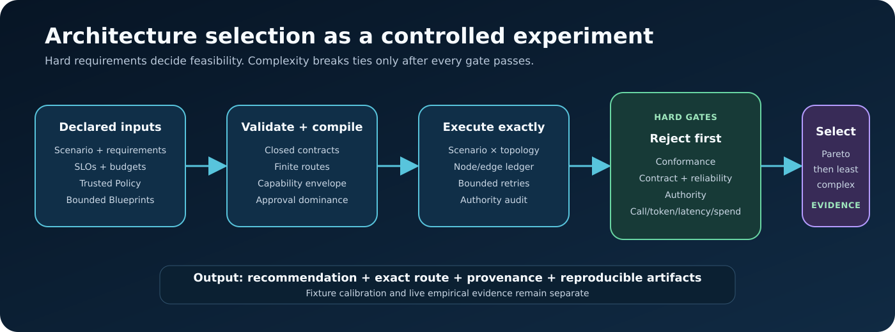
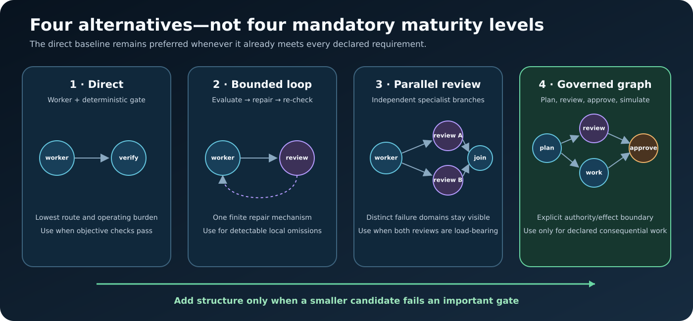

# Architecture

## Design objective

Agent Wind Tunnel makes a small set of agent architectures comparable and
auditable. The runtime owns the topology; model adapters implement declared
roles but do not choose hidden routes or expand their own permissions.

The design favors a constrained compiler over a permissive interpreter:
unsupported roles, predicates, contracts, policies, and route semantics fail
validation instead of becoming inert metadata.



## System context

```text
operator
  │
  ├── scenario selection, candidate selection, repetitions, budgets
  │
  ▼
CLI ──► catalog + schemas ──► validator/compiler
                                  │
                                  ▼
                     runner + execution ledger
                         │             │
                         │             └── authority broker
                         ▼
              fixture adapter or OpenAI adapter
                         │
                         ▼
                result and report builder
                         │
                         ▼
       JSON · NDJSON · Markdown · HTML · manifest
```

The trusted policy and runner remain outside the portable graph. A Blueprint
may request a capability that the policy knows, but it cannot add a capability
to the catalog, enlarge a scope, mint an approval, or mutate the initial grant
envelope.

## Main components

| Component | Source | Responsibility |
| --- | --- | --- |
| CLI | `agent-wind-tunnel.mjs` | Parse commands, select studies, preview live call envelopes, require explicit live confirmation, and invoke report generation |
| Catalog | `lib/catalog.mjs` | Build four canonical blueprints, four synthetic composite scenarios, trusted fixture policy, and source provenance |
| Schemas | `schemas/*.json` | Publish portable shapes for Blueprint, Scenario, and Policy data |
| Validator/compiler | `lib/validate.mjs` | Validate closed shapes, bounds, roles, contracts, routes, cycles, features, and authority dominance; compile supported execution behavior |
| Runner | `lib/runner.mjs` | Execute scenario × topology × repetition cells, reserve budgets, validate role outputs, apply gates, aggregate results, and select candidates |
| Execution ledger | `lib/execution-ledger.mjs` | Record and enforce exact node visits, edge traversals, declared outcomes, per-node limits, per-edge limits, and the global visit limit |
| Authority broker | `lib/authority.mjs` | Enforce the immutable grant envelope, bind one-time fixture approvals to a specific run/artifact/effect, and invoke only the built-in data simulator |
| Contracts and checks | `lib/contracts.mjs`, `lib/checks.mjs` | Validate closed role envelopes and evaluate declared deterministic requirements |
| Experiment inputs | `lib/experiment-inputs.mjs` | Validate and load immutable Scenario Packs and exact-model Price Cards with hashes, provenance, and claim boundaries |
| Fixture adapter | `lib/fixture-adapter.mjs` | Provide deterministic, scenario-calibrated role behavior without exposing private oracle metadata to the runner-facing adapter input |
| OpenAI adapter | `lib/openai-adapter.mjs` | Call the Responses API with structured role contracts, bounded application-owned retries, metadata capture, and no fixture fallback |
| Ablation engine | `lib/ablations.mjs` | Evaluate checked-in Graph Max variants after canonical topology selection |
| Reporter | `lib/report.mjs` | Produce canonical machine artifacts and reader-oriented Markdown/HTML reports |
| Artifact verifier | `scripts/verify-artifacts.mjs` | Recompute listed hashes and byte counts and reject missing or unexpected package members |

## Blueprint IR

The Blueprint intermediate representation is vendor-neutral data, but the
runtime accepts only the node kinds and behavior families it implements.

Closed node kinds:

```text
model | deterministic | fork | join | approval | effect | terminal
```

Every node has a unique ID, a positive `maxVisits`, a declared kind, and—when
applicable—a role contract, thread label, and requested capabilities. Every
edge has a unique ID, source, target, closed outcome predicate, and positive
`maxTraversals`. Every Blueprint has a global `maxNodeVisits` and resource
budgets.

Cycles are permitted only when their visits and traversals are finite. Feature
metadata must agree with executable topology. A feature flag cannot cause
planning, review, synthesis, approval, or an effect to execute when the
corresponding nodes and routes are absent.

### Canonical topology families

| Family | Structural intent |
| --- | --- |
| `direct` | One worker followed by deterministic verification and a terminal decision |
| `loop` | Worker, verifier, and one bounded evaluator/repair cycle |
| `parallel-review` | Worker output reviewed by independent specialist branches and joined before a bounded repair decision |
| `graph-max-governed` | Planning and plan review, worker execution, specialist review, synthesis/repair, optional presentation, and an explicit approval/effect boundary |



This is a closed family compiler, not an engine for arbitrary graph programs.
Adding a new node label to JSON does not add runtime behavior; a new family
requires implementation, validation rules, contracts, tests, and reporting.

## Validation and compilation

Before a candidate runs, validation checks include:

- exact top-level and nested shapes;
- unique and reachable nodes and edges;
- entry and terminal requirements;
- positive node, edge, and global bounds;
- accepted state, input, and output contracts;
- role-to-node and thread-to-kind bindings;
- closed edge predicates and supported outcome-to-target transitions;
- agreement between feature declarations and actual topology;
- catalogued capabilities and allowed scopes;
- immutable initial grants for model calls;
- effect-class and approval-policy combinations;
- approval dominance on every path to a consequential effect.

The compiler binds the validated graph to the transition behavior implemented
by the runner. This prevents a graph from appearing different in data while
silently executing the same hard-coded route.

## Execution model

Each run has one immutable Blueprint, public Scenario view, Policy, Adapter,
repetition number, and optional approval provider.

1. The runner compiles and validates the candidate.
2. The execution ledger records entry into the declared start node.
3. Before each model attempt, the runner reserves model-call and logical-visit
   budget and asks the broker to validate every requested capability.
4. The adapter receives a frozen, public input for one declared role.
5. Role output is checked against its closed contract and allowed references.
6. The runtime records the emitted outcome and exact declared edge.
7. Parallel work reserves combined budgets before dispatch and accounts for
   every branch that actually starts.
8. Deterministic checks and reviewer findings may select a bounded repair edge.
9. A terminal status is recorded as accepted, rejected, escalated, contract
   error, timeout, budget exhaustion, refusal, or API error.

The ledger does not infer routes. Entering a node and traversing an edge are
separate explicit operations so fork/join behavior remains visible.

## Authority boundary


The authority mechanism has two distinct paths:

- **Ordinary model capabilities:** a request is allowed only when it was
  compiled for that node and is already inside the immutable initial grants.
  Otherwise the run escalates.
- **Consequential simulated effect:** the graph must declare one effect with a
  unique dominating approval node. Approval is bound to the run, scenario,
  Blueprint, accepted artifact hash, capability, scope, approval node, and
  effect node. Idempotency prevents the same binding from executing twice in
  the simulator.

The default live path has no human approval connector and therefore fails
closed at a required consequential boundary. Only fixture mode receives the
explicit fixture approval provider used by the deterministic demonstration.

The broker invokes no arbitrary callback and performs no external deployment.
It is an architectural example, not production IAM or sandboxing.

## Adapter boundary

### Fixture mode

Fixture mode is deterministic. Private fault descriptions and expected
outcomes calibrate the adapter, but the adapter invocation receives only the
public Scenario view and declared prior artifacts. The tests check that private
oracle fields do not cross that boundary.

Usage-like values are synthetic cost units and virtual latency ticks. Fixture
role invocations are simulated role calls.

### Live mode

Live mode uses the official OpenAI SDK and Responses API. It preserves the same
role and topology contracts, records returned usage and identifiers, and
labels every result nondeterministic. It never silently substitutes fixture
behavior.

The CLI requires one of two explicit intents:

- `--dry-run`: zero API calls and a conservative call-envelope preview;
- `--confirm-live`: authorization to read the configured key and execute, only
  when a validated exact-model Price Card and explicit spend ceiling are
  present and the plan fits both its call and spend ceilings.

An optional Price Card produces a conservative spend envelope by pricing
declared per-run token budgets at the highest applicable exact-model token
rate. Confirmed live work requires that card and
`--max-live-spend-usd`. Results retain the card snapshot and realized estimate.
These are auditable estimates, not provider invoices.

Fixture and live results are never pooled.

## Selection model

Selection is constraint-first:

```text
static validity
    → conformance and mandatory checks
    → contract and bounded-termination checks
    → authority and approval checks
    → resource budgets
    → Pareto pruning
    → least structural complexity among feasible candidates
```

There are three different recommendations:

1. **Per scenario:** the smallest canonical topology that passes that case.
2. **Universal canonical:** the smallest one candidate that passes the entire
   selected corpus.
3. **Within-family:** after a canonical family is chosen, the smallest declared
   ablation that still passes.

Keeping these questions separate prevents a lean Graph Max ablation from being
mistaken for the best route for every simple task.

## Evidence package

Fixture output contains:

```text
wind-tunnel-output/fixture/
├── manifest.json
├── blueprints.json
├── policy.json
├── fixtures.json
├── results.json
├── execution.ndjson
├── trace.ndjson
├── report.md
└── report.html
```

`trace.ndjson` contains metadata about role calls and excludes prompt and
output bodies. `execution.ndjson` contains logical visits and transitions.
`results.json` retains run, aggregate, recommendation, provenance, and
ablation data. The manifest lists package membership, byte counts, and hashes;
it intentionally does not hash itself.

## Graph Max provenance

`lib/catalog.mjs` performs a bounded source-pattern scan of the adjacent
`graph-max-code-mode-annotated.mjs`, records its SHA-256, confirms observed
roles and a parallel join, and derives the canonical governed Blueprint.

The governed candidate retains the observed planner, plan reviewer, worker,
structure reviewer, correctness reviewer, task-fidelity reviewer, synthesizer,
and presenter roles. It adds deterministic verification, explicit fork/join
and terminal nodes, a security reviewer, a broker-owned approval node, and a
brokered effect simulator.

The scan is pattern-based evidence for this source file. It is not a
JavaScript AST compiler and makes no general claim about deriving graphs from
arbitrary programs.

## Extension points

A production-oriented extension should preserve the claim boundaries:

- add representative scenarios and executable checks;
- implement new adapters behind the same immutable role boundary;
- export traces to an observability/evaluation platform;
- integrate a real approval provider without reusing fixture credentials or
  the simulated effect;
- add a topology family only with compiler bindings, authority rules, tests,
  and report support;
- version Price Cards and recompute estimates whenever rate, model, service
  tier, context tier, region, caching, or tool-charge assumptions change.

See [Methodology](methodology.md) for experimental design and
[Threat model](threat-model.md) for security assumptions.
