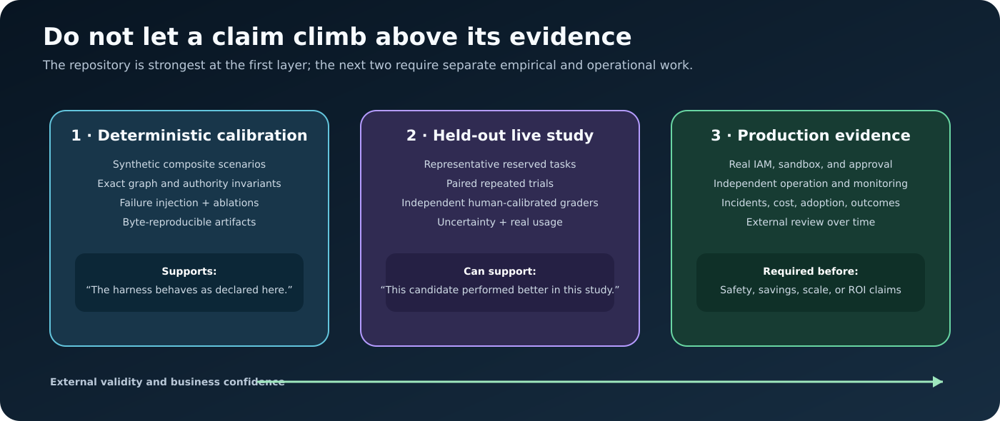

# Product brief

## Product statement

Agent Wind Tunnel is an offline-first architecture evaluation harness. Given a
small declared set of agent topologies, scenarios, service-level objectives,
and a trusted capability policy, it identifies the least complex evaluated
candidate that satisfies every hard gate.

It is designed for an architecture decision before production—not for serving
end-user requests.

## Problem

Agent teams can add planning, reflection, specialist reviewers, handoffs, and
approval steps without knowing whether the additional orchestration improves a
real outcome. Conventional success demos rarely isolate topology from model,
prompt, tools, evidence, or task differences. The result can be:

- unnecessary model calls and latency;
- more routes and failure modes to operate;
- a larger permission and approval surface;
- unclear ownership of quality failures;
- architecture discussions driven by diagrams rather than comparable
  evidence.

## Intended users

| User | Decision supported |
| --- | --- |
| Applied AI or agent engineer | Which bounded workflow should implement a task class? |
| AI platform or evaluation engineer | How should topology variants be compared under fixed controls? |
| Product or operations lead | Which quality, latency, reliability, and cost gates matter? |
| Security or risk partner | Where must capability, approval, and effect boundaries appear? |
| Engineering leader | Which added components have evidence that justifies their maintenance burden? |

## Job to be done

> When several agent architectures could implement the same workflow, compare
> them under one declared contract so that we can select the smallest feasible
> design and retain an auditable explanation.

## Inputs, decision process, and outputs

### Inputs

- **Scenarios:** public task material, weighted requirements, mandatory checks,
  SLOs, budgets, and—only in fixture mode—private synthetic fault metadata.
- **Blueprints:** a closed, vendor-neutral graph representation with named
  nodes, edges, outcomes, capabilities, and bounds.
- **Trusted policy:** capability catalog, scopes, effect classes, approval
  rules, and initial immutable grants.
- **Adapter:** deterministic fixture behavior or live OpenAI Responses API
  behavior under the same role contracts.
- **Portable study inputs:** versioned Scenario Packs with provenance and claim
  boundaries, plus optional exact-model Price Cards with rate provenance,
  effective date, and pricing assumptions.

### Decision process

1. Validate scenario, policy, topology, contracts, cycles, and authority paths.
2. Compile the accepted topology into the supported execution family.
3. Execute each scenario × topology × repetition cell with exact route
   accounting.
4. Apply conformance, contract, authority, reliability, and budget gates.
5. Remove infeasible candidates before considering complexity.
6. Compute the Pareto set and select the smallest evaluated feasible
   candidate.
7. Within the selected family, run declared ablations to test which components
   are load-bearing.

### Outputs

- scenario-level and whole-corpus recommendations;
- raw and aggregate measurements;
- exact node/edge execution ledgers;
- metadata-only role-call traces;
- authority decisions and simulated effect events;
- canonical blueprints, policy, and fixture descriptions;
- Markdown and self-contained HTML reports with no third-party browser runtime;
- a manifest with file membership, byte counts, and SHA-256 hashes.
- retained Scenario Pack and Price Card snapshots when those inputs are used;
- conservative pre-run call/spend envelopes and realized live estimates when a
  valid Price Card is supplied.

## Value hypothesis

The product hypothesis is that a constraint-first comparison can help teams:

- avoid orchestration that does not repair a measured failure;
- make quality, authority, and budget tradeoffs explicit;
- expose which graph components are causally load-bearing in a declared study;
- produce an evidence package that engineering, product, operations, and risk
  stakeholders can inspect together.

These are hypotheses, not measured commercial outcomes of the current
repository. The project has no production adoption or ROI evidence included.

## Current evidence

The implementation includes deterministic replay, topology and policy
validation, exact bounded route accounting, injected failure handling,
authority-envelope checks, a data-only consequential-effect simulator,
ablation studies, a live adapter with explicit call confirmation, and
artifact-integrity verification.

The default corpus is a **synthetic composite calibration suite**. It is useful
for demonstrating harness behavior and testing regressions. It is not a
representative user benchmark and has no independent semantic grader.

The `scenarios/enterprise-portfolio/` materials add nine fictional
initiative dossiers, six calibration cases, and three cases stored separately
from calibration. Those three remain synthetic composites rather than
external validation. The optional review kit ships with a blank review sheet;
there are no completed human reviews or calibrated labels.

One separately labeled bounded live pilot compared `direct` with `loop` on one
synthetic scenario, using one OpenAI model/configuration and three repetitions
per candidate. All six runs passed the local structural/lexical rubric; after
that tie, `direct` was selected for lower complexity. The sample used nine
model calls, 12,019 tokens, zero retries, and a USD 0.08756 Price Card estimate.
It used `semanticGrader: none`, and named test-case strings were counted rather
than executed. No Graph Max candidate ran live. This is not a benchmark,
generalization, production, savings, ROI, or provider-invoice claim.
[Inspect the bounded live-pilot evidence](../evidence/live-pilot-2026-07-28.json).

## Product boundaries

Agent Wind Tunnel is deliberately:

- closed-world rather than a general graph interpreter;
- an evaluation laboratory rather than an agent serving runtime;
- deterministic by default rather than dependent on a model account;
- fail-closed for unsupported contracts, permissions, and routes;
- effect-free outside a built-in data simulator;
- explicit about fixture, live, and production evidence being different
  layers.

It does not provide real IAM, a sandbox, a production approval connector,
arbitrary tool execution, multi-tenant isolation, model hosting, or a
general-purpose semantic grading service.

## Adoption path

### Reference demonstration

Run the checked-in fixtures, tests, inspection, report, and manifest verifier.
Use this stage to understand the contracts and decide whether the decision
model fits the organization.

### Pilot study

Replace calibration cases with representative held-out work. Hold model,
effort, tools, prompts, evidence, and authority constant. Run repeated trials,
add executable checks and independent graders calibrated to human labels, and
report uncertainty rather than a single winning run.

### Production engineering

Integrate with the organization’s eval, tracing, IAM, sandbox, approval,
secret-management, and deployment systems. Re-run the study when models,
prompts, tools, policies, task distributions, or costs change. Do not promote
the included effect simulator into a production control.

## Success measures for a real pilot

- mandatory task-success and safety requirements;
- defect escape rate by severity;
- contract failure and refusal rates;
- approval and escalation rates;
- model calls, retries, tokens, wall-clock latency, and provider cost;
- incident or rollback indicators for a safely simulated environment;
- sensitivity of the recommendation across repetitions, graders, models, and
  complexity weights;
- maintenance burden of the retained graph components.

The appropriate thresholds are organization- and task-specific. This
repository does not prescribe universal values.

## Product maturity

Current status: experimental reference implementation and evaluation harness.
The next high-value evidence is a decision-grade matched study on held-out,
representative tasks with independent grading—not a larger catalog of
unvalidated graph types.
