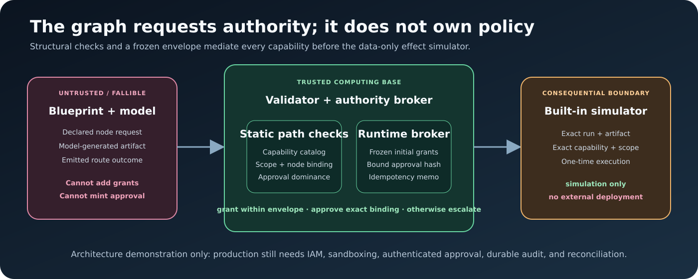

# Threat model

## Status

This threat model describes a local experimental harness. It helps reviewers
understand the security properties the code attempts to enforce and the
properties it explicitly does not provide.

Agent Wind Tunnel is not a production authorization system, sandbox, identity
provider, deployment service, or formal verification engine.

## Security objectives

The implementation aims to:

1. reject unsupported or unbounded graph behavior before execution;
2. prevent model output or graph metadata from expanding the declared
   capability envelope;
3. require a declared approval-dominated route before a consequential
   simulated effect;
4. bind approval to one run, artifact, capability, scope, and effect;
5. bound model attempts, logical visits, edge traversals, retries, and live
   call plans;
6. preserve enough metadata to reconstruct the selected logical route;
7. avoid putting secrets or prompt/output bodies into fixture reports;
8. fail closed when a live approval provider or API credential is absent.

## Assets

- API credentials supplied by the operator;
- scenario data and artifacts;
- trusted Policy and initial grant envelope;
- Blueprint definitions and compiled routes;
- approval decision and binding;
- model usage budget;
- evidence package and provenance;
- integrity of the selection recommendation.

## Trust boundaries

### Trusted for this implementation

- local runtime and validation code;
- trusted Policy loaded by the catalog;
- initial capability grants;
- schemas and closed contract implementations;
- fixture approval provider in deterministic tests;
- operator intent expressed through CLI confirmation;
- built-in data-only effect simulator.

### Untrusted or fallible

- Blueprint and Scenario data until validated;
- model output and model-provided references;
- adapter labels and errors;
- environment and key files;
- filesystem output paths supplied at the CLI;
- external model service availability and returned metadata;
- generated report content before escaping and integrity verification;
- future third-party adapters, tools, or approval providers.

The fixture adapter is deterministic but is not an independent evaluator. Its
private calibration fields are trusted only as test data.

## Threats, controls, and remaining risk

| Threat | Implemented control | Residual risk / production requirement |
| --- | --- | --- |
| Graph declares unknown behavior | Closed shapes, node kinds, roles, outcomes, and contract bindings; unsupported combinations fail | Validator correctness is trusted; this is not formal verification |
| Unbounded loop or route | Positive `maxVisits`, `maxTraversals`, and global `maxNodeVisits`; cycles and runtime ledger checked | Process-level CPU/memory controls and sandboxing are still required |
| Metadata claims a feature the graph lacks | Features are validated against reachable topology and compiled behavior | A new compiler family could introduce a mismatch without equivalent tests |
| Model invokes a node without a declared transition | The ledger requires source entry and one matching declared edge; runner reserves logical entry | Bugs in trusted runner code remain in the trusted computing base |
| Model or graph invents a capability | Closed capability catalog, compiled per-node requests, immutable initial grant envelope | Real tool enforcement must occur outside the model and outside this simulator |
| Scope escalation | Requested scope must be compiled for the requester and present in initial grants | Production scope semantics, tenancy, and resource ownership are not modeled |
| Approval bypass to an effect | Static path-dominance check requires an approval node on every path to a consequential effect | Dominance proves graph structure, not identity, intent, or human review quality |
| Reuse of approval for another artifact/effect | Approval binding hashes run, scenario, Blueprint, artifact, nodes, capability, and scope | A real system needs authenticated approvers, expiry, revocation, durable audit, and secure token storage |
| Duplicate consequential action | Idempotency key and binding memo allow the built-in simulator to execute once | Distributed idempotency and partial external effects are not modeled |
| Arbitrary external side effect | Broker exposes only its built-in data-only simulator; no arbitrary effect callback | Any real tool/effect connector requires a separate security design |
| Budget race in parallel work | Model-call and visit budgets are reserved before dispatch; parallel waves account for started siblings | Provider-side work can still complete after client cancellation; monetary reconciliation is provider-specific |
| Retry storm or systemic provider failure | Bounded retries, error classification, observed paid-usage accounting, and circuit breaking | Distributed clients and provider outages need centralized rate and cost controls |
| Unintended API spending | Dry-run call envelope, explicit `--confirm-live`, and configurable maximum call ceiling | The envelope is conservative, not a billing guarantee; provider pricing is external |
| Missing live human approval | Default provider escalates and live consequential scenario fails closed | A production-grade connector is intentionally absent |
| Secret printed in logs or arguments | Documentation directs keys to environment/key file; resolver does not print key values; trace excludes prompt/output bodies | Shell history, process environment, SDK/network logging, and local file permissions remain operator responsibilities |
| Fixture oracle leaks into model input | Runner passes a public Scenario projection; tests check private fixture fields are absent | Future scenario fields must be reviewed when the public projection changes |
| Prompt injection in task content | Model output remains contract-bound and has no arbitrary tool authority in this demo | Semantic prompt-injection resistance is not established; production requires tool isolation and data provenance |
| Malformed model response | Strict role envelopes, contract validation, reference validation, and fail-closed status | Schema-valid but malicious or semantically wrong text remains possible |
| Output path escape | Output paths are constrained to the package boundary by path checks | Symlink, permission, quota, and multi-user filesystem concerns require deployment hardening |
| Report injection | Reporter escapes values rendered into self-contained HTML with no third-party browser runtime | Treat generated files as untrusted until reviewed; browser and future template changes remain risks |
| Evidence package modified after run | Manifest records membership, bytes, and SHA-256; verifier rejects mismatches and unexpected members | The manifest is not signed and does not hash itself; no external timestamp or attestation exists |
| Curated public evidence is altered or over-expanded | Strict shape, duplicate-key, path, secret-pattern, price-card hash, arithmetic, aggregate, Pareto, and recommendation checks fail closed in CI | Raw-source commitments are unsigned and the unpublished bundle cannot be independently reproduced |
| Supply-chain compromise | Lockfile pins package resolution; Dependabot monitors declared dependencies; fixture mode has a small dependency set | No SBOM, signature verification, hermetic build, or independent supply-chain attestation is included |
| Model/provider nondeterminism | Live mode is labeled empirical; returned IDs/config and usage are recorded; no fixture pooling | Provider internals and aliases can change; reproducibility is not guaranteed |

## Authority is not permission creation

The broker recognizes two different operations:

1. A model node requests a capability already compiled for it and already
   present in the frozen grant envelope. The broker may confirm it as
   `granted-within-envelope`.
2. A consequential effect requests a separately bound approval. That approval
   authorizes only the declared data-only simulator for the exact accepted
   artifact and binding.

Neither path lets a model mint a new grant. An `approved` fixture event should
not be interpreted as a reusable token, operating-system permission, cloud
role, or production deployment authorization.

## Data and privacy

Fixture traces are metadata-only and exclude prompt/output bodies. The public
live record is a metrics-only projection; raw prompts, outputs, traces, and
provider request/response identifiers remain unpublished. That minimization
does not by itself provide confidentiality or external attestation.
Before using organization data:

- classify the task and evidence;
- review provider retention and regional controls;
- minimize prompt content;
- use an approved secret store;
- restrict local artifact permissions;
- define trace redaction and deletion;
- avoid personal or regulated data unless the complete environment is
  approved for it.

The sample repository should contain no real API key. `.env.example` documents
the variable name only.

## Abuse cases intentionally out of scope

- executing arbitrary user-supplied tools;
- shell, browser, network, or code-execution sandboxing;
- authenticating users or approvers;
- tenant separation and row-level data authorization;
- production deployments or rollback;
- adversarial model-weight or provider compromise;
- cryptographic attestation of reports;
- distributed approval and idempotency;
- formal noninterference or information-flow proof;
- general dynamic graph invention.

These omissions are reasons to integrate with production platform controls,
not features to add casually to the demonstration.

## Production hardening checklist

Before adapting the design to a consequential system:

- put tools behind an independently enforced, least-privilege broker;
- use workload identity rather than reusable API credentials;
- sandbox code and network access;
- authenticate and authorize approvers;
- bind approvals to immutable artifacts with expiry and revocation;
- implement durable, distributed idempotency and reconciliation;
- add signed audit logs and external retention;
- threat-model prompt injection and untrusted retrieved data;
- add SAST, dependency scanning, SBOM, secret scanning, and provenance;
- implement tenant and data-classification boundaries;
- test cancellations, timeouts, partial effects, and disaster recovery;
- conduct independent security review and incident exercises.

## Reporting a vulnerability

Do not publish secrets or exploit details in a public issue. Follow
[SECURITY.md](../SECURITY.md) to request a private reporting channel.
